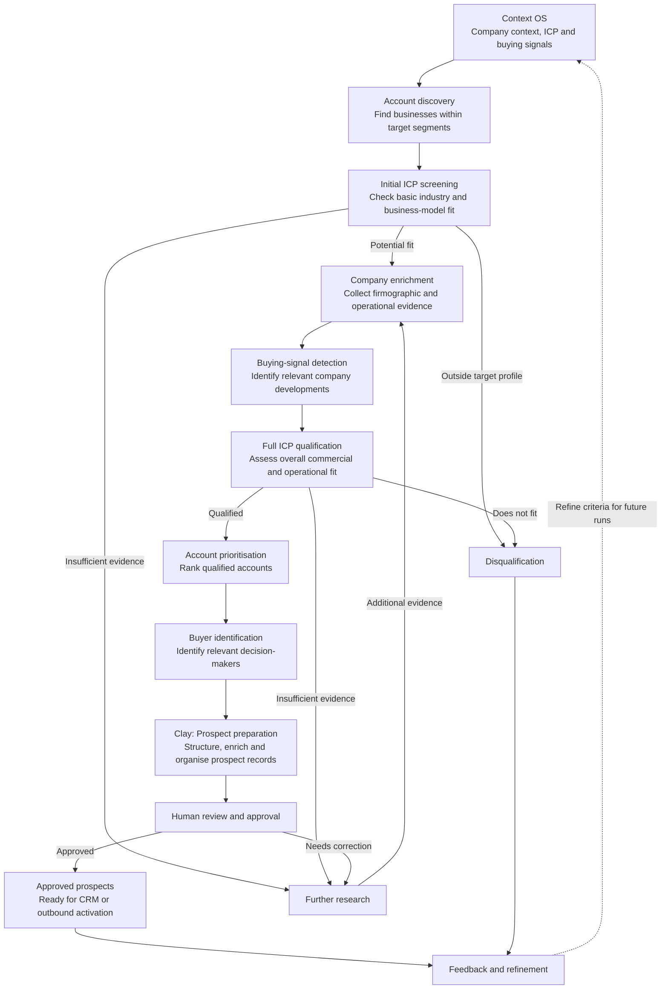

# Moniepoint GTM Systems Architecture

## 1. System Objective

Design a GTM system that identifies, researches, qualifies and prioritises Nigerian businesses that may have relevant banking, payments and financial operations needs.

The initial target segments are:

- Retail supermarket chains.
- FMCG distributors.
- Fuel and service stations.
- General retail and service SMEs.

Initial commercial prioritisation focuses on retail chains and FMCG distributors, subject to evidence of ICP fit and relevant operational complexity.

The system uses publicly observable company information and buying signals to produce evidence-backed prospecting recommendations.

ICP definitions, customer pain points, buying signals and qualification thresholds are treated as research findings or hypotheses rather than established market facts. Moniepoint product capabilities must be verified against authoritative company sources before specific product-fit claims are made.

## 2. End-to-End GTM Workflow

The GTM system is organised around the following operational stages:

1. Account discovery.
2. Initial ICP screening.
3. Company enrichment.
4. Buying-signal detection.
5. Full ICP qualification.
6. Account prioritisation.
7. Buyer identification.
8. Clay-based prospect preparation.
9. Human review and approval.
10. Feedback and refinement.

The first seven stages establish whether an account is commercially relevant and identify its potential buyers. Clay provides the proposed environment for organising and processing prospect information. Human review determines whether a prospect is ready for activation.

Feedback and refinement operate alongside the workflow. They improve future prospecting runs rather than restarting the current account's journey.

### Architecture diagram

The feedback connection represents future improvements to the Context OS and its supporting criteria. It does not send every completed account back to discovery.

Further research is an account-level exception path. Where additional information is obtained, the account returns to enrichment for reassessment.

## 3. Workflow Components

### Stage 1: Account Discovery

**Objective:** Find businesses that may fit the target customer profile.

**Inputs:**

- Target industries and business segments from `icp/icp.md`.
- Company directories and public business databases.
- Company websites.
- Business expansion announcements.
- Relevant industry publications.

**Process:**

- Search for businesses within the defined target segments.
- Identify company names, websites and operating locations.
- Record where each company was discovered.
- Remove duplicate company records.
- Retain the discovery source and date.

**Outputs:**

- Initial account list.
- Company name and website where available.
- Industry or business segment.
- Discovery source and date.

**Failure handling:**

- Unverifiable businesses are excluded.
- Incomplete records are retained for investigation where useful.
- Duplicate records are consolidated.
- Businesses outside the initial target segments are not automatically enriched.

### Stage 2: Initial ICP Screening

**Objective:** Apply basic ICP criteria before investing resources in detailed company research and enrichment.

**Inputs:**

- Initial account list.
- Target segments and industry criteria from `icp/icp.md`.
- Available company descriptions and public profiles.

**Process:**

Conduct an initial assessment of:

- Industry and business model.
- Geographic relevance to the Nigerian market.
- Whether the company operates within a relevant target segment.
- Whether its business model could involve relevant banking, payments or financial operations needs.

This is an initial screening exercise, not a final commercial qualification decision.

**Outputs:**

Each account receives one of three screening outcomes:

- Potential fit.
- Outside target profile.
- Insufficient information.

**Failure handling:**

- Clearly unrelated businesses are excluded.
- Accounts with insufficient information are retained for further research where justified.
- Uncertainty is not treated as evidence of poor fit.
- No account is disqualified solely because a buying signal has not yet been detected.

### Stage 3: Company Enrichment

**Objective:** Gather the firmographic and operational information needed for a detailed commercial assessment.

**Inputs:**

- Accounts that pass initial ICP screening.
- Company websites and public profiles.
- Business announcements.
- Available operational and firmographic information.

**Process:**

Collect available information on:

- Industry and business model.
- Headquarters and operating locations.
- Number of branches or outlets.
- Distribution and warehouse operations.
- Company size indicators.
- Evidence of geographic or operational expansion.
- Available information about financial and operational structures.
- Publicly observable payment and collection activities, where available.

**Outputs:**

- Enriched company records.
- Source URLs and supporting evidence.
- Research and verification dates.
- Missing-information indicators.

**Failure handling:**

- Unknown information remains explicitly unknown.
- Unverified branch counts and company-size estimates are not treated as facts.
- Accounts with insufficient information move to further research.
- Conflicting information is flagged for verification.

### Stage 4: Buying-Signal Detection

**Objective:** Identify observable developments that may indicate increasing operational or financial complexity, or a relevant change in the company's commercial circumstances.

**Initial signals defined in `icp/signals.md`:**

1. Finance and treasury recruitment.
2. Multi-branch or geographic expansion.
3. Operations, warehouse and logistics recruitment.

**Inputs:**

- Enriched company records.
- Public recruitment listings.
- Company announcements.
- Relevant business publications.

**Process:**

- Search for evidence of the defined signals.
- Match detected signals to companies.
- Record publication dates and source URLs.
- Assess relevance, recency and evidence quality.
- Identify combinations of signals.
- Distinguish current developments from historical information.

**Signal interpretation:**

- Finance and treasury recruitment indicates investment in financial management capability. It does not independently establish intent to purchase or replace financial software.
- Multi-branch expansion indicates potential growth in payment and reconciliation complexity. Verify the company's actual operating footprint.
- Warehouse and logistics recruitment indicates operational development. Its commercial relevance depends on the company's business model and financial workflows.

Signals provide additional commercial context. They are not substitutes for ICP criteria and are not mandatory conditions for qualification.

**Outputs:**

- Detected buying signals.
- Evidence and source references.
- Publication and detection dates.
- Confidence and relevance assessments.
- Signal combinations where applicable.

**Failure handling:**

- Unverifiable signals are rejected.
- Old or undated evidence is flagged.
- Conflicting evidence requires verification.
- Multiple signals are assessed together without automatically assuming purchase intent.
- The absence of a detectable signal does not automatically reduce an otherwise strong ICP fit.

### Stage 5: Full ICP Qualification

**Objective:** Determine whether a business has sufficient commercial and operational alignment with Moniepoint's target customer profile.

**Inputs:**

- ICP criteria from `icp/icp.md`.
- Enriched company records.
- Detected buying signals.
- Supporting company and product evidence.

**Process:**

Assess:

- Industry and business model alignment.
- Physical operating footprint.
- Transaction characteristics and operational complexity.
- Volume and frequency of customer collections, where evidence is available.
- Number of payment collection points.
- Complexity of reconciling incoming payments across locations.
- Working capital and supplier payment requirements, where evidence is available.
- Relevant financial functions and organisational maturity.
- Potential relevance of Moniepoint's verified banking and payment capabilities.

**Initial qualification benchmarks:**

- **Excellent fit:** Businesses with a substantial physical operating footprint, high-frequency transactions and evidence of complex payment collection or financial operations. Five or more physical locations is an initial indicator of potential fit, not a mandatory threshold.
- **Reasonable fit:** Single-location high-volume retailers or distributors with evidence of relevant payment, collection or financial management needs.
- **Poor fit:** Businesses with low transaction volumes or business models that show little apparent relevance to the verified products and services being considered.

These are preliminary qualification hypotheses and require validation against actual prospect data.

Finance or treasury recruitment, geographic expansion and operational hiring may strengthen the assessment, but none is a mandatory condition for an excellent ICP fit.

The absence of recruitment or expansion signals must not automatically disqualify an otherwise suitable business.

**Outputs:**

Each account receives one of three qualification outcomes:

- Qualified.
- Disqualified.
- Further research required.

The account also receives an ICP fit score from 1 to 10, supported by an explanation of the criteria and available evidence.

**Failure handling:**

- Businesses clearly outside the ICP are disqualified.
- Insufficient evidence results in further research, not automatic qualification.
- Preliminary ICP assumptions are not treated as verified customer requirements.
- Accounts with high transaction volumes but limited operating footprints are assessed against their actual payment and collection complexity rather than rejected solely on branch count.
- Product-fit assumptions that cannot be verified remain explicitly qualified as hypotheses.

### Stage 6: Account Prioritisation

**Objective:** Rank qualified accounts according to their potential commercial relevance and the strength of the available evidence.

**Inputs:**

- Qualified company records.
- ICP fit assessments.
- Signal relevance and recency.
- Evidence quality.
- Number of independently supported signals.
- Evidence of payment collection and reconciliation complexity.

**Process:**

Prioritise accounts based on:

- Strength of ICP fit.
- Relevance of detected buying signals.
- Recency of supporting evidence.
- Presence of multiple complementary signals.
- Confidence in the available information.
- Evidence of payment collection and reconciliation complexity.
- Relevance to the initial commercial focus on retail chains and FMCG distributors.

For example, verified geographic expansion combined with recent finance or treasury recruitment may justify higher priority than either signal independently.

However, an account with strong operational fit should not automatically receive a low priority simply because it has no detectable recruitment signal.

**Outputs:**

- Prioritised account list.
- Priority assessment.
- Supporting evidence and rationale.
- Recommended next action.

**Failure handling:**

- Weak or contradictory evidence triggers manual review.
- Multiple weak signals do not automatically constitute a strong prospect.
- Accounts without sufficient evidence remain outside the highest-priority group.
- Prioritisation criteria are documented and applied consistently.

### Stage 7: Buyer Identification

**Objective:** Identify relevant decision-makers and influencers within qualified businesses.

**Inputs:**

- Prioritised account records.
- Public professional profiles.
- Company leadership information.
- Buying committee assumptions from the ICP.

**Potential buyer roles:**

- Founder or Managing Director.
- Chief Financial Officer.
- Head of Finance.
- Treasury Manager.
- Financial Controller.

The relevant buyer depends on company size, organisational structure and the nature of the potential banking or payment requirement.

**Process:**

- Identify relevant individuals.
- Associate individuals with their companies and current roles.
- Determine their likely relevance to banking and payment decisions.
- Record source URLs and verification dates.
- Distinguish decision-makers from potential influencers.

**Outputs:**

- Buyer and influencer records.
- Job titles and company associations.
- Public professional profile references where available.
- Verification status.

**Failure handling:**

- Accounts without identifiable decision-makers remain qualified.
- Unverified job titles and contact information are flagged.
- Missing buyer information triggers further research.
- Unverified individuals are not presented as confirmed decision-makers.

### Stage 8: Clay-Based Prospect Preparation

**Objective:** Organise, enrich and prepare qualified company and buyer information into structured prospect records using Clay as the proposed GTM execution and orchestration environment.

**Inputs:**

- Qualified and prioritised account records.
- Company enrichment data.
- Buying-signal evidence.
- Identified decision-makers.
- ICP fit and priority assessments.

**Proposed process:**

- Import or connect researched account records to Clay.
- Organise company and contact information into structured fields.
- Enrich missing company or contact information using available and appropriate data sources.
- Apply documented qualification and prioritisation criteria.
- Preserve evidence URLs, source dates and verification status.
- Prepare account-level and contact-level records for human review.

**Expected prospect record:**

- Company name.
- Website.
- Industry.
- Operating locations.
- Branch count where verified.
- ICP fit score and qualification outcome.
- Detected buying signals.
- Evidence and source URLs.
- Signal dates.
- Evidence confidence.
- Priority level.
- Prioritisation rationale.
- Identified buyer roles.
- Contact verification status.
- Suggested outreach angle.

**Outputs:**

- Structured company records.
- Structured buyer and contact records.
- Enriched prospect data.
- Evidence-backed qualification and prioritisation fields.
- Prospect records ready for review.

**Failure handling:**

- Failed enrichments are flagged rather than populated with fabricated information.
- Duplicate companies and contacts are identified.
- Missing or conflicting fields remain visible.
- Unverified data is not treated as confirmed.
- Clay integrations and enrichment actions are not considered operational until configured and tested.

### Stage 9: Human Review and Approval

**Objective:** Validate prospect records and approve suitable prospects before commercial activation.

**Inputs:**

- Structured Clay prospect records.
- ICP qualification results.
- Buying-signal evidence.
- Prioritisation rationale.
- Identified buyer information.
- Proposed outreach angles.

**Process:**

A human reviewer assesses:

- Whether the company genuinely fits the ICP.
- Whether the supporting evidence is credible and current.
- Whether the detected buying signals are correctly interpreted.
- Whether the prioritisation is justified.
- Whether the identified buyer is relevant.
- Whether the proposed outreach angle is commercially appropriate.

**Outputs:**

Each prospect receives one of the following review outcomes:

- Approved.
- Rejected.
- Further research required.

Approved prospects are ready for CRM or outbound activation.

**Failure handling:**

- Incomplete records return to further research.
- Contradictory information requires verification.
- Incorrect qualification decisions are corrected.
- No prospect enters an automated outbound sequence without the required human approval.

### Stage 10: Feedback and Refinement

**Objective:** Improve future account discovery, qualification and prioritisation using observed results and operational feedback.

This is a continuous improvement process, not another mandatory step in an individual account's journey.

**Inputs:**

- Human review decisions.
- Approved and rejected prospects.
- Disqualified accounts.
- Incorrect or outdated signals.
- Prospect engagement.
- Available sales feedback.
- Available CRM and outbound performance data.

**Process:**

- Identify recurring false positives.
- Assess which signals produce relevant prospects.
- Review qualification and prioritisation decisions.
- Identify weaknesses in company discovery and enrichment sources.
- Refine ICP and signal definitions using supporting evidence.
- Improve scoring criteria and workflow rules.
- Update relevant project documentation and operational playbooks.

**Outputs:**

- Refined ICP criteria.
- Updated buying-signal definitions.
- Improved qualification and prioritisation rules.
- Better research and enrichment procedures.
- Documented operational learnings.

Feedback informs future runs and relevant workflow components. Changes to the ICP or signal framework should be supported by evidence rather than isolated prospect outcomes.

## 4. Data and Evidence Management

Each account and detected signal should retain its supporting evidence throughout the workflow.

The system should preserve:

- Company identifiers and website URLs.
- Source URLs.
- Source publication dates.
- Research and verification dates.
- Evidence excerpts.
- Signal classifications.
- Signal confidence and relevance.
- Qualification decisions.
- ICP fit scores.
- Prioritisation decisions.
- Decision rationale.
- Buyer and contact verification status.
- Human review outcomes.

Facts, inferences and hypotheses must remain distinguishable.

Research source registers are maintained separately for ICP and buying-signal research under `research/`.

Source identifiers must resolve to the correct research register. ICP source references must not be reused as buying-signal references without independently verifying that the source is included in both registers.

Account-level prospecting evidence should also be retained independently of the general ICP and signal research registers. This allows individual prospect assessments to be traced back to the specific sources used.

## 5. Implementation Status

### Existing components

The repository currently contains:

- `CLAUDE.md` for project instructions and context navigation.
- `icp/icp.md` for initial ICP research.
- `icp/signals.md` for buying-signal research.
- `research/icp/source_register.json` for ICP research sources.
- `research/signals/source_register.json` for buying-signal research sources.
- `tools/generate_icp.py` for automated ICP research and synthesis.
- `tools/generate_signals.py` for automated buying-signal research and synthesis.
- `tools/gemini_helper.py` for Gemini-related functionality.
- `.claude/skills/icp-check/SKILL.md` for company-level ICP evaluation instructions.

The existing Python scripts support public-source research, webpage extraction, AI-assisted synthesis and research documentation.

The ICP-check skill defines how an individual company should be evaluated. It does not, by itself, implement the complete account discovery and qualification workflow.

### Proposed components

The broader GTM workflow still requires implementation and validation in areas including:

- Account discovery.
- Initial ICP screening.
- Structured company enrichment.
- Repeatable buying-signal detection.
- Full account-level ICP qualification.
- Prospect scoring and prioritisation.
- Buyer identification.
- Clay-based prospect preparation and enrichment.
- Human review and approval.
- Structured prospect output.
- Feedback and performance measurement.

Clay is the proposed execution and orchestration environment for the account-level prospecting workflow.

CRM and outbound integrations may be considered as downstream activation components. They should not be represented as operational until configured and tested.

The intended operational endpoint is an approved, evidence-backed prospect record ready for CRM or outbound activation. Actual campaign execution is outside the initial implementation scope unless explicitly added and validated.

## 6. Design Principles

1. **ICP-guided discovery:** The ICP informs account discovery and initial screening from the beginning of the workflow.

2. **Progressive qualification:** Initial screening uses basic company information. Full qualification uses enriched company data and additional evidence.

3. **Separate fit from intent:** ICP suitability and buying-signal strength are assessed independently. A strong ICP fit does not require a currently detectable buying signal.

4. **Evidence before assumptions:** Every material prospect claim should have supporting evidence.

5. **Qualification before prioritisation:** Accounts must be assessed for ICP fit before receiving commercial priority.

6. **Signals indicate relevance, not guaranteed intent:** Observable events are proxies that require interpretation.

7. **Preserve uncertainty:** Missing information must not be converted into fabricated facts.

8. **Human oversight:** Prospect qualification and outreach recommendations require review before activation.

9. **Operational progression:** Qualified accounts move towards structured prospect records and approval rather than repeatedly restarting the discovery process.

10. **Continuous improvement:** New evidence and operational feedback should inform future ICP and signal refinements.
