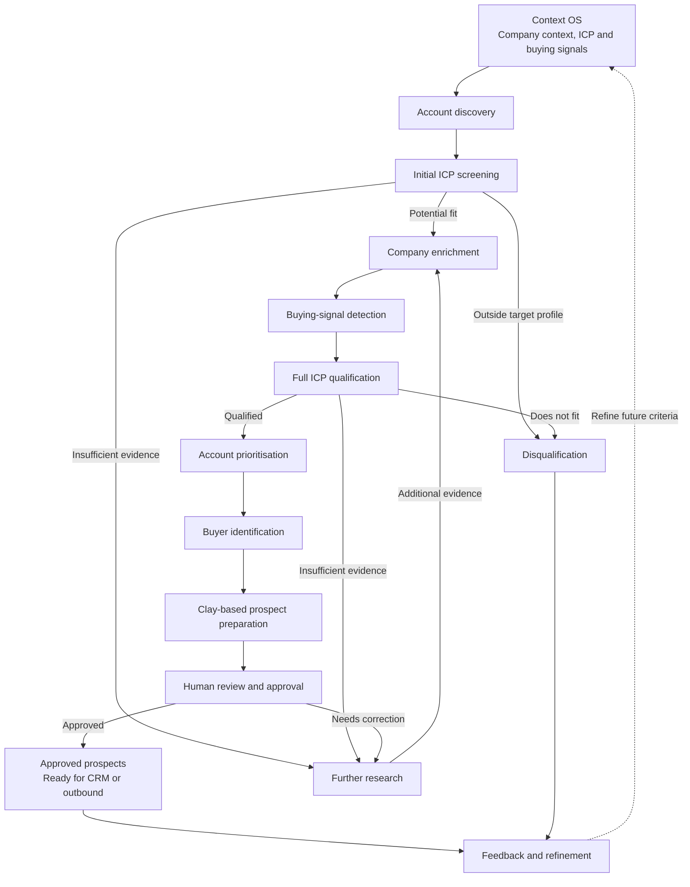

# Moniepoint GTM Systems Architecture

## 1. System Objective

Design a GTM system that identifies, researches, qualifies and prioritises Nigerian businesses with potential banking, payment and financial operations needs.

**Initial target segments:**

- Retail supermarket chains
- FMCG distributors
- Fuel and service stations
- General retail and service SMEs

Initial commercial prioritisation focuses on retail chains and FMCG distributors, subject to evidence of ICP fit and operational relevance.

The system uses publicly available company information and observable buying signals to produce evidence-backed prospecting recommendations.

ICP definitions, customer pain points, buying signals and qualification thresholds are treated as research hypotheses until validated. Moniepoint product capabilities must be verified against authoritative sources.

## 2. End-to-End Architecture

The system consists of ten operational stages:

1. Account discovery
2. Initial ICP screening
3. Company enrichment
4. Buying-signal detection
5. Full ICP qualification
6. Account prioritisation
7. Buyer identification
8. Clay-based prospect preparation
9. Human review and approval
10. Feedback and refinement

### Architecture diagram

Feedback improves future prospecting runs rather than restarting completed accounts. Further research returns an account to enrichment for reassessment.

## 3. Core System Components

| Component              | Responsibility                                                                         |
| ---------------------- | -------------------------------------------------------------------------------------- |
| Context OS             | Maintains company context, ICP definitions, buying signals and operating instructions. |
| Account discovery      | Identifies businesses within the target segments using public sources.                 |
| Company enrichment     | Collects firmographic, operational and commercial evidence.                            |
| Signal detection       | Identifies relevant developments such as recruitment and geographic expansion.         |
| ICP qualification      | Evaluates commercial and operational fit.                                              |
| Account prioritisation | Ranks qualified accounts using fit, evidence and signal relevance.                     |
| Buyer identification   | Identifies relevant decision-makers and influencers.                                   |
| Clay                   | Proposed environment for enrichment, structuring and prospect preparation.             |
| Human review           | Validates prospect records before activation.                                          |
| Feedback               | Improves future research and qualification criteria.                                   |

## 4. Qualification and Prioritisation Logic

The system distinguishes between two independent assessments:

**ICP fit:** How closely does the business match the target customer profile?

**Buying intent:** What observable evidence suggests a relevant business need or reason to engage?

ICP fit considers:

- Industry and business model
- Geographic and physical operating footprint
- Transaction volume and frequency, where available
- Payment collection and reconciliation complexity
- Financial and operational requirements
- Potential relevance of verified Moniepoint products

Buying signals initially include:

- Finance and treasury recruitment
- Multi-branch or geographic expansion
- Warehouse, logistics and operations recruitment

These signals indicate potential relevance, not confirmed purchase intent. Their recency, reliability and commercial significance must be assessed.

### Preliminary qualification outcomes

| Outcome        | Interpretation                                                              |
| -------------- | --------------------------------------------------------------------------- |
| Excellent fit  | Strong operational and commercial alignment supported by evidence.          |
| Reasonable fit | Relevant business model with some demonstrated banking or payment needs.    |
| Poor fit       | Limited apparent alignment with the products and services being considered. |

Five or more physical locations is an initial indicator of potential fit, not a mandatory threshold. High-volume single-location businesses may also qualify where their payment and collection complexity supports it.

Qualified accounts are prioritised using ICP fit, signal relevance, evidence quality, recency and commercial rationale. The absence of a detected buying signal does not automatically disqualify a strong ICP fit.

The detailed qualification criteria are maintained in `icp/icp.md` and `icp/signals.md`.

## 5. Data and Evidence Management

The system preserves research provenance throughout account qualification.

Each prospect record should retain:

- Company name and website
- Industry and operating locations
- Source URLs and publication dates
- Research and verification dates
- Supporting evidence
- Detected buying signals
- Signal confidence and relevance
- ICP qualification outcome and score
- Prioritisation rationale
- Identified buyers and verification status
- Human review decision

Facts, inferences and hypotheses must remain distinguishable. Unknown or conflicting information must be flagged rather than presented as verified.

Research source registers are maintained separately:

- `research/icp/source_register.json`
- `research/signals/source_register.json`

Source identifiers must resolve to the correct register. Account-level evidence should also be retained independently so individual prospect decisions can be traced to their supporting sources.

## 6. Technology and Implementation

### Existing implementation

| Technology / Component | Current use                                    |
| ---------------------- | ---------------------------------------------- |
| Python                 | Research orchestration and data handling       |
| DDGS                   | Public web search                              |
| Trafilatura            | Webpage content extraction                     |
| Gemini API             | AI-assisted research synthesis                 |
| JSON                   | Structured source registers                    |
| Markdown               | Research documentation and system instructions |

Existing scripts automate public-source discovery, webpage extraction, source registration and preliminary ICP and buying-signal synthesis.

The repository also contains:

- `CLAUDE.md` for project context and operating instructions.
- `.claude/skills/icp-check/SKILL.md` for ICP evaluation guidance.
- `architecture.md` for system design.
- `workflow.md` for operational workflow details.

### Proposed implementation

Clay is intended to support account-level enrichment, qualification, prioritisation and prospect preparation.

The following capabilities remain to be configured, implemented and tested:

- Automated account discovery and screening
- Structured account-level enrichment
- Repeatable buying-signal detection
- Automated qualification and prioritisation
- Buyer identification
- Clay enrichment and workflow integrations
- Human review and approval
- CRM and outbound activation

The current Python scripts automate research and documentation. They do not yet implement the complete account-level GTM workflow.

## 7. Operational Output

The intended output is an approved, evidence-backed prospect record containing:

- Company and operating information
- ICP fit assessment
- Buying signals and supporting evidence
- Priority and qualification rationale
- Relevant decision-makers
- Suggested outreach angle
- Verification and review status

Approved records can then be prepared for CRM or outbound activation.

Campaign execution is outside the initial implementation scope unless separately configured and validated.

## 8. Design Principles

1. **Evidence-led decisions:** Material prospect claims require supporting sources.
2. **Progressive qualification:** Basic screening precedes detailed enrichment and assessment.
3. **Separate fit from intent:** ICP suitability does not depend on detecting a buying signal.
4. **Preserve uncertainty:** Missing information is not treated as negative evidence or fabricated fact.
5. **Qualification before prioritisation:** Commercial priority follows ICP assessment.
6. **Human oversight:** Prospect records require review before external engagement.
7. **Traceable decisions:** Qualification and prioritisation outcomes retain their supporting evidence.
8. **Continuous refinement:** New evidence and operational feedback improve future prospecting criteria.
