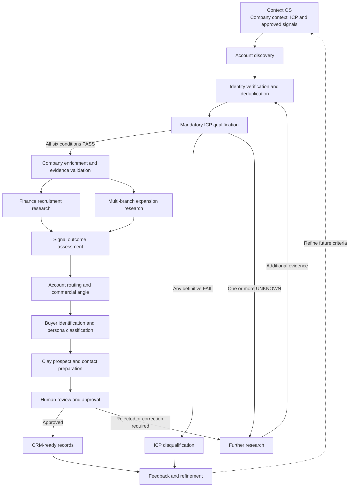

# Moniepoint GTM Systems Architecture

## 1. System Objective

Design a GTM system that identifies, researches, qualifies and prioritises Nigerian businesses with potential banking, payment and financial operations needs.

**Initial target segments:**

- Retail supermarket chains (`RETAIL_SUPERMARKET`)
- FMCG distributors (`FMCG_DISTRIBUTOR`)

The initial implementation is restricted to these two segments. Fuel and service stations, general retail and service SMEs, and other unrelated business categories are outside the approved workflow scope.

Initial commercial prioritisation focuses on retail chains and FMCG distributors, subject to evidence of ICP fit and operational relevance.

The system uses publicly available company information and observable buying signals to produce evidence-backed prospecting recommendations.

ICP definitions, customer pain points, buying signals and qualification thresholds are treated as research hypotheses until validated. Moniepoint product capabilities must be verified against authoritative sources.

## 2. End-to-End Architecture

The system consists of ten operational stages:

The system consists of ten operational stages:

1. Account discovery
2. Business identity verification and deduplication
3. Mandatory ICP qualification
4. Company-level enrichment and evidence validation
5. Independent finance recruitment and multi-branch expansion research
6. Signal outcome assessment and account routing
7. Buyer identification and persona classification
8. Clay-based prospect preparation and contact enrichment
9. Human review and approval
10. CRM preparation and feedback

### Architecture diagram

The two signal searches are independent. Both must reach terminal outcomes before final signal routing. An unresolved search must not be treated as NOT_DETECTED.

## 3. Core System Components

| Component              | Responsibility                                                                                               |
| ---------------------- | ------------------------------------------------------------------------------------------------------------ |
| Context OS             | Maintains company context, ICP definitions, buying signals and operating instructions.                       |
| Account discovery      | Identifies businesses within the two approved target segments.                                               |
| Company enrichment     | Establishes identity, Nigerian operations, physical operating model and other mandatory ICP evidence.        |
| Signal detection       | Independently investigates finance recruitment and multi-branch expansion after mandatory ICP qualification. |
| ICP qualification      | Evaluates the six mandatory conditions using PASS, FAIL or UNKNOWN.                                          |
| Account prioritisation | Applies deterministic routing using both signal outcomes, evidence quality and commercial relevance.         |
| Buyer identification   | Identifies relevant decision-makers and influencers after account qualification and routing.                 |
| Clay                   | Supports account enrichment, signal research, contact preparation and workflow execution.                    |
| Human review           | Validates evidence, qualification, routing and contact readiness before approval.                            |
| Feedback               | Improves future research and qualification criteria.                                                         |

## 4. Qualification and Prioritisation Logic

The system distinguishes between two independent assessments:

**ICP fit:** How closely does the business match the target customer profile?

**Buying intent:** What observable evidence suggests a relevant business need or reason to engage?

**ICP fit:** Whether the business satisfies the six mandatory qualification conditions defined in `workflow.md`.

Each condition receives one of three outcomes:

- PASS
- FAIL
- UNKNOWN

Overall qualification:

- `QUALIFIED`: All six conditions PASS.
- `DISQUALIFIED`: At least one condition definitively FAILS.
- `FURTHER_RESEARCH`: No condition FAILS, but at least one remains UNKNOWN.

Missing evidence must not be treated as a negative finding.

Buying signals are restricted to two approved categories:

- `FINANCE_RECRUITMENT`: Relevant finance, treasury, accounting or financial operations recruitment.
- `MULTI_BRANCH_EXPANSION`: Verified or attributable expansion of physical retail or distribution operations.

Warehouse, logistics and operations recruitment may be retained as supplementary research observations, but must not operate as an independent buying signal or influence current routing.

### Preliminary qualification outcomes

| ICP outcome        | Interpretation                                                    |
| ------------------ | ----------------------------------------------------------------- |
| `QUALIFIED`        | All six mandatory ICP conditions have passed.                     |
| `DISQUALIFIED`     | At least one mandatory ICP condition has definitively failed.     |
| `FURTHER_RESEARCH` | No definitive failure, but one or more conditions remain unknown. |

### Fit Tier and Signal Routing

Fit tier is assessed separately from mandatory ICP qualification:

- `EXCELLENT_FIT`
- `REASONABLE_FIT`
- `UNASSESSED`

Five or more physical locations is a prioritisation heuristic, not a mandatory qualification threshold. A qualifying single-location supermarket may still be included. FMCG distributors do not need retail outlets if their distribution operations are independently verified.

Signal outcomes are assessed independently:

- `DETECTED`
- `NOT_DETECTED`
- `UNVERIFIED`
- `HISTORICAL`
- `UNKNOWN`

The two signal outcomes determine routing according to the combination matrix in `workflow.md`.

The absence of a detected signal does not disqualify an otherwise qualified account. An unresolved signal search must not be interpreted as `NOT_DETECTED`.

A buying signal does not establish purchase intent, dissatisfaction with an existing provider or a confirmed payment problem.

The controlling qualification and routing rules are maintained in `workflow.md`. Supporting market research and signal context are maintained in `icp/icp.md` and `icp/signals.md`.

## 5. Data and Evidence Management

The system preserves research provenance throughout account qualification.

Each prospect record should retain:

- Company name, verified identity and website/domain
- Nigerian operating presence and supporting evidence
- Approved business segment
- Physical operating footprint
- Evidence for each of the six mandatory ICP conditions
- Individual ICP condition outcomes: `PASS`, `FAIL` or `UNKNOWN`
- Overall ICP qualification outcome: `QUALIFIED`, `DISQUALIFIED` or `FURTHER_RESEARCH`
- Fit tier and supporting rationale: `EXCELLENT_FIT`, `REASONABLE_FIT` or `UNASSESSED`
- Finance recruitment search status and outcome
- Multi-branch expansion search status and outcome
- Signal evidence records, source URLs and relevant dates
- Search coverage, unresolved candidates and research limitations
- Signal combination and routing outcome
- Commercial angle and next action
- Identified buyers, personas and verification status
- Human review decision and CRM preparation status

Facts, inferences and hypotheses must remain distinguishable. Unknown or conflicting information must be flagged rather than presented as verified.

Research source registers are maintained separately:

- `research/icp/source_register.json`
- `research/signals/source_register.json`

Source identifiers must resolve to the correct register. Account-level evidence should also be retained independently so individual prospect decisions can be traced to their supporting sources.

## 6. Technology and Implementation

### Existing implementation

| Technology / Component | Current use                                    |
| ---------------------- | ---------------------------------------------- |
| Python                 | Research orchestration and data handling       |
| DDGS                   | Public web search                              |
| Trafilatura            | Webpage content extraction                     |
| Gemini API             | AI-assisted research synthesis                 |
| JSON                   | Structured source registers                    |
| Markdown               | Research documentation and system instructions |

Existing scripts automate public-source discovery, webpage extraction, source registration and preliminary ICP and buying-signal synthesis.

The repository also contains:

- `CLAUDE.md` for project context and operating instructions.
- `.claude/skills/icp-check/SKILL.md` for ICP evaluation guidance.
- `architecture.md` for system design.
- `workflow.md` for operational workflow details.

### Proposed implementation

Clay is intended to support account-level enrichment, qualification, prioritisation and prospect preparation.

The following capabilities remain to be configured, implemented and tested:

- Account discovery within the two approved segments
- Business identity verification and deduplication
- Six-condition mandatory ICP qualification
- Company-level enrichment and evidence validation
- Independent finance recruitment research
- Independent multi-branch expansion research
- Signal outcome assessment and deterministic account routing
- Buyer identification and persona classification
- Clay enrichment and contact preparation
- Verified work-email research and contact-readiness checks
- Human review and approval
- CRM preparation and feedback

The current Python scripts automate research and documentation. They do not yet implement the complete account-level GTM workflow.

## 7. Operational Output

The intended output is an approved, evidence-backed prospect record containing:

- Company and verified operating information
- ICP qualification assessment and fit tier
- Finance recruitment and multi-branch expansion signals with supporting evidence
- Signal combination, routing outcome and prioritisation rationale
- Relevant decision-makers and personas
- Suggested commercial angle and next action
- Verification, human review and CRM preparation status

An account reaching `CRM_READY` means it has passed the required qualification, evidence and human approval checks and is ready for CRM processing. It does not mean the record has already been synchronised with a CRM or that outreach has been initiated.

Approved records can then be prepared for CRM integration or outbound activation, subject to the relevant implementation and approval requirements.

Campaign execution is outside the initial implementation scope unless separately configured and validated.

## 8. Design Principles

1. **Evidence-led decisions:** Material prospect claims require supporting sources.
2. **Progressive qualification:** Basic screening precedes detailed enrichment and assessment.
3. **Separate fit from intent:** ICP suitability does not depend on detecting a buying signal.
4. **Preserve uncertainty:** Missing information is not treated as negative evidence or fabricated fact.
5. **Qualification before prioritisation:** Commercial priority follows ICP assessment.
6. **Human oversight:** Prospect records require review before external engagement.
7. **Traceable decisions:** Qualification and prioritisation outcomes retain their supporting evidence.
8. **Continuous refinement:** New evidence and operational feedback improve future prospecting criteria.
