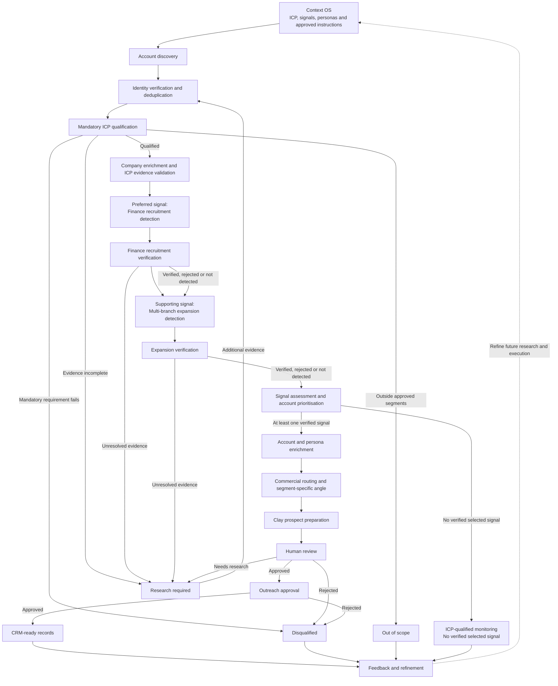

# Moniepoint GTM Systems Architecture

## 1. System Objective

Design and implement an evidence-led GTM system that discovers, qualifies, researches and prioritises Nigerian businesses within Moniepoint's approved Ideal Customer Profile (ICP).

The system identifies qualified businesses, detects relevant commercial events, researches buying roles and produces evidence-backed account records with defensible commercial angles for human review.

### Approved ICP scope

The system covers all seven segments defined in `icp.md`, retaining their approved priority classifications.

| Priority  | Segment                                        | Segment code             |
| --------- | ---------------------------------------------- | ------------------------ |
| PRIMARY   | FMCG Distributors and Wholesalers              | `FMCG_DISTRIBUTOR`       |
| PRIMARY   | Petrol Station Networks                        | `PETROL_STATION_NETWORK` |
| PRIMARY   | Retail Chains (Supermarkets)                   | `RETAIL_SUPERMARKET`     |
| SECONDARY | Quick-Service Restaurant Groups                | `QSR_GROUP`              |
| SECONDARY | Pharmacy Chains                                | `PHARMACY_CHAIN`         |
| EMERGING  | Logistics and Haulage                          | `LOGISTICS_HAULAGE`      |
| EMERGING  | Specialized Healthcare and Diagnostic Networks | `HEALTHCARE_DIAGNOSTICS` |

Segment priority determines campaign and research priority. It does not establish ICP qualification.

The initial campaign priority remains the three PRIMARY segments. SECONDARY and EMERGING segments remain within the approved research universe but must retain their classifications in the system. They must not be silently promoted into the primary campaign cohort.

### Selected buying signals

The system operates around two selected signals:

- **Preferred signal:** `FINANCE_RECRUITMENT`
- **Supporting signal:** `MULTI_BRANCH_EXPANSION`

Finance recruitment is the principal detection and routing signal. Expansion provides supporting evidence that can strengthen prioritisation or independently support a segment-specific commercial angle.

Neither signal can override ICP qualification.

The system uses publicly available company information and observable business events. Material account and signal decisions must retain their supporting evidence and research provenance.

ICP definitions, signal interpretations and commercial value propositions must follow their respective authority documents. Product capabilities and eligibility must not be assumed from ICP fit or signal detection.

---

## 2. End-to-End Architecture

The architecture consists of ten operational stages.

1. Account discovery.
2. Business identity verification and deduplication.
3. Mandatory ICP qualification.
4. Company enrichment and ICP evidence validation.
5. Preferred finance recruitment detection and verification.
6. Supporting expansion detection and verification.
7. Signal assessment, account prioritisation and commercial routing.
8. Account and buying-role enrichment, including Clay preparation.
9. Human review and outreach approval.
10. CRM preparation and feedback.

The architecture follows the workflow sequence:

`ACCOUNT DISCOVERY → ICP QUALIFICATION → FINANCE RECRUITMENT DETECTION → FINANCE RECRUITMENT VERIFICATION → EXPANSION DETECTION → EXPANSION VERIFICATION → SIGNAL SCORING → ACCOUNT AND PERSONA ENRICHMENT → COMMERCIAL ROUTING → HUMAN REVIEW → OUTREACH APPROVAL`

### Architecture diagram

**Architecture rules:**

- ICP qualification precedes signal detection.
- `FINANCE_RECRUITMENT` is the preferred signal and is researched first.
- `MULTI_BRANCH_EXPANSION` is researched after the preferred signal and provides supporting evidence.
- Each signal has its own detection outcome, verification outcome and confidence assessment.
- An unresolved signal search must never be treated as `NOT_DETECTED`.
- An account with no verified selected signal can remain ICP-qualified for future monitoring.
- Only ICP-qualified accounts enter qualified signal prioritisation.
- Commercial routing must use the verified segment and actual signal event.
- Human review and outreach approval remain separate controls.

---

## 3. Core System Components

| Component                      | Responsibility                                                                                               |
| ------------------------------ | ------------------------------------------------------------------------------------------------------------ |
| Context OS                     | Maintains approved ICP definitions, signal specifications, persona guidance and system instructions.         |
| Account discovery              | Identifies potential businesses across the seven approved ICP segments.                                      |
| Identity verification          | Establishes company identity, Nigerian operating presence and relevant operating entity.                     |
| ICP qualification              | Evaluates general qualification requirements, segment-specific mandatory conditions and anti-ICP exclusions. |
| Company enrichment             | Captures operating model, locations and evidence needed to support ICP decisions.                            |
| Preferred signal detection     | Searches for relevant finance, treasury, financial control, accounting and finance operations vacancies.     |
| Supporting signal detection    | Searches for segment-specific expansion events and operational developments.                                 |
| Signal verification            | Establishes event attribution, source credibility, event status and relevance.                               |
| Account prioritisation         | Applies the approved hierarchy using ICP priority and independently verified signal outcomes.                |
| Account and persona enrichment | Identifies relevant decision-makers, influencers and functional buying roles.                                |
| Commercial routing             | Assigns the correct segment-specific angle based on verified events.                                         |
| Clay                           | Supports account enrichment, linked signal evidence, contact preparation and workflow execution.             |
| Human review                   | Checks qualification, evidence, attribution, routing and contact readiness.                                  |
| Outreach approval              | Controls whether an approved account and contact can proceed to outreach.                                    |
| CRM preparation                | Produces approved records for subsequent CRM processing.                                                     |
| Feedback                       | Captures research outcomes and operational findings to improve future execution.                             |

---

## 4. Qualification and Prioritisation Logic

The system maintains separate assessments for ICP qualification, signal detection, signal verification, signal confidence, account priority and contact readiness.

These assessments must not be collapsed into a single prospect score.

### 4.1 ICP qualification

ICP qualification determines whether a business belongs to the approved target market and satisfies the applicable mandatory requirements.

The qualification authority is `workflow.md`, supported by the segment definitions in `icp.md`.

The system evaluates:

- Nigerian operating presence.
- Business and operating-entity identity.
- Approved segment membership.
- Active operating status.
- Applicable segment-specific mandatory requirements.
- Anti-ICP exclusions.

Segment-specific requirements must be applied without inventing numerical thresholds or additional mandatory conditions.

Examples:

- FMCG distributors must demonstrate multiple depots or significant warehousing and trade receivables or credit-based sales.
- Petrol station networks must own or manage at least three stations and demonstrate daily cash/POS reconciliation.
- Supermarket accounts must demonstrate a verifiable supermarket chain and attributable branch network. No minimum branch count is imposed by the workflow.
- Secondary and emerging segments must demonstrate their approved operating models without invented numerical qualification thresholds.

### 4.2 Qualification outcomes

| Outcome             | Interpretation                                                                    | System treatment                   |
| ------------------- | --------------------------------------------------------------------------------- | ---------------------------------- |
| `QUALIFIED`         | General and applicable segment-specific requirements are verified.                | Enter qualified signal workflow.   |
| `RESEARCH_REQUIRED` | The business may qualify, but required evidence is incomplete.                    | Hold for further research.         |
| `DISQUALIFIED`      | A mandatory requirement fails or an applicable anti-ICP exclusion is established. | Exclude from qualified pipeline.   |
| `OUT_OF_SCOPE`      | The business does not belong to an approved ICP segment.                          | Exclude from current ICP workflow. |

Missing evidence must not be treated as a definitive negative finding.

A detected signal cannot qualify an otherwise disqualified account.

### 4.3 Signal selection and interpretation

The selected signals are:

| Priority   | Signal                   | System role                                                        |
| ---------- | ------------------------ | ------------------------------------------------------------------ |
| PREFERRED  | `FINANCE_RECRUITMENT`    | Principal detection, verification and commercial routing signal.   |
| SUPPORTING | `MULTI_BRANCH_EXPANSION` | Secondary detection, enrichment and account prioritisation signal. |

**Preferred signal: `FINANCE_RECRUITMENT`**

The system searches for current vacancies involving finance, treasury, financial control, accounting and relevant finance operations.

Relevant role titles include Finance Manager, Financial Controller, Treasury Manager, Head of Finance, Group Accountant, Finance Operations Manager and Treasury Lead.

Role responsibilities must be assessed. A job title alone does not establish signal relevance.

The system records:

- Advertised employer and its relationship to the target account.
- Vacancy title and responsibilities.
- Vacancy status.
- Seniority and functional relevance.
- New-role or replacement status where ascertainable.
- Source URL and relevant dates.

A finance vacancy may indicate investment in financial oversight. It does not establish switching intent, payment friction, credit demand or purchasing authority.

**Supporting signal: `MULTI_BRANCH_EXPANSION`**

The system searches for the segment-specific expansion events defined in `signals.md` and `workflow.md`.

Examples include:

- FMCG warehouse or depot commissioning and regional distribution expansion.
- Petrol station commissioning, CNG/EV infrastructure investment and non-fuel retail diversification.
- Supermarket branch expansion.
- QSR outlet expansion.
- Pharmacy acquisitions and new locations.
- Logistics fleet expansion and new haulage contracts.
- New diagnostic centres and relevant healthcare operating expansion.

The actual event type must be preserved. Infrastructure investment, acquisitions, contracts and fleet expansion must not automatically be classified as branch-count growth.

### 4.4 Signal detection and verification outcomes

Detection and verification are separate assessments.

| Field                        | Permitted values                                                          | Meaning                                                   |
| ---------------------------- | ------------------------------------------------------------------------- | --------------------------------------------------------- |
| `signal_detection_status`    | `DETECTED`, `NOT_DETECTED`, `RESEARCH_REQUIRED`                           | Whether the selected event was detected.                  |
| `signal_verification_status` | `VERIFIED`, `UNVERIFIED`, `REJECTED`, `RESEARCH_REQUIRED`, `NOT_ASSESSED` | Whether detected evidence has been assessed and accepted. |
| `signal_confidence`          | `STRONG`, `MODERATE`, `WEAK`, `UNASSESSED`                                | Strength of the evidence supporting the event.            |

A signal cannot be counted as verified unless its event is attributable to the target account and supported by an adequate evidence record.

A signal that was not detected is not the same as a signal that was detected and rejected.

An unresolved search remains unresolved.

### 4.5 Signal combination

The account-level signal combination is derived from independently verified signal evidence.

| Verified finance recruitment | Verified expansion | Signal combination |
| ---------------------------- | ------------------ | ------------------ |
| Yes                          | No                 | `FINANCE_ONLY`     |
| No                           | Yes                | `EXPANSION_ONLY`   |
| Yes                          | Yes                | `BOTH`             |
| No                           | No                 | `NONE`             |

If either search remains unresolved, the account must retain the appropriate research state. An unresolved result must not be converted into `NONE`.

### 4.6 Account prioritisation

The approved research-priority hierarchy is:

1. PRIMARY ICP account with both independently verified signals.
2. PRIMARY ICP account with verified `FINANCE_RECRUITMENT`.
3. PRIMARY ICP account with verified `MULTI_BRANCH_EXPANSION`.
4. SECONDARY ICP account with one or both verified signals.
5. EMERGING ICP account with one or both verified signals.
6. ICP-qualified account with no selected signal.
7. Accounts with unresolved ICP or signal evidence remain in a research queue.

Fit tier, signal confidence and research priority remain distinct fields.

A high-priority account is not necessarily more likely to purchase. Prioritisation establishes research and campaign sequencing, not measured conversion probability.

---

## 5. Account Routing and Commercial Angles

Commercial routing is based on three inputs:

1. Verified ICP segment.
2. Verified signal event or combination of events.
3. Relevant financial or operating workflow associated with the event.

The routing matrix in `workflow.md` is the authority for the commercial angle.

Every approved segment must have a defined angle for both selected signals.

### 5.1 Preferred-signal routing

When `FINANCE_RECRUITMENT` is verified, the finance-recruitment angle is the default.

The system should investigate relevant financial workflows, including:

- Collections and cash management.
- Cash, POS and transfer reconciliation.
- Treasury and supplier-payment operations.
- Financial control across operating locations.
- Working-capital coordination.
- Consolidated financial reporting.

### 5.2 Supporting-signal routing

When only `MULTI_BRANCH_EXPANSION` is verified, use the segment-specific expansion angle.

When both signals are verified, use finance recruitment as the primary commercial angle and use the independently verified expansion event to make the investigation more specific.

### 5.3 Commercial value proposition mapping

Potential Moniepoint relevance may include:

| Business context                                   | Potential relevance                         | Permitted interpretation                                                 |
| -------------------------------------------------- | ------------------------------------------- | ------------------------------------------------------------------------ |
| Multi-location cash, POS and transfer operations   | Payment acceptance and financial management | Investigate collections and reconciliation requirements.                 |
| Settlement timing and liquidity sensitivity        | Instant settlement                          | Explore whether settlement timing affects operating cash flow.           |
| Trade receivables and supplier-payment obligations | Working capital                             | Investigate working-capital requirements without assuming credit demand. |
| Additional branches, stations, depots or centres   | Multi-location financial management         | Investigate consolidated reporting and financial coordination.           |
| Finance function expansion                         | Financial oversight and treasury operations | Investigate changes in financial control and reporting requirements.     |

These are commercial investigation hypotheses. They do not establish product suitability, credit eligibility or an existing business problem.

---

## 6. Data and Evidence Management

The architecture preserves evidence provenance from discovery through qualification, signal verification, routing and human review.

### 6.1 Account records

Each account record should retain:

- Stable account identifier.
- Verified company and legal-entity identity where available.
- Company website and Nigerian operating presence.
- Approved ICP segment and segment priority.
- Active operating status.
- Operating model and physical footprint.
- Evidence for applicable mandatory ICP requirements.
- Individual qualification outcomes and overall ICP status.
- Finance recruitment detection and verification outcomes.
- Expansion detection and verification outcomes.
- Signal combination and account research priority.
- Commercial angle and potential value proposition.
- Identified buying roles and contact verification outcomes.
- Workflow state and review decisions.

### 6.2 Signal evidence records

Each detected event must have its own linked signal evidence record.

Each record should retain:

- Stable `signal_id`.
- Related `account_id`.
- Signal type and signal priority.
- Actual event type.
- Detection status and verification status.
- Signal confidence.
- Event and detection dates where available.
- Source URL.
- Factual evidence summary.
- Signal-specific fields, such as finance-role responsibilities or expansion details.

Multiple signal records may belong to one account.

The absence of a signal record must not automatically be interpreted as a completed search with a `NOT_DETECTED` outcome.

### 6.3 Contact records

Contacts are maintained separately from account qualification.

Each contact record should retain:

- Stable `contact_id`.
- Related `account_id`.
- Verified name and job title where available.
- Functional classification and seniority.
- Source URL.
- Contact verification status.
- Contact relevance.

Missing contact information does not disqualify an account.

### 6.4 Evidence integrity

The system must distinguish:

- Verified facts.
- Research observations.
- Inferences.
- Commercial hypotheses.
- Unknown or conflicting information.

Every material qualification and signal decision must retain its supporting source or explicitly record why evidence is unavailable.

Account-level decisions must be traceable to their evidence records.

### 6.5 Source registers

Research source registers are maintained separately:

- `research/icp/source_register.json`
- `research/signals/source_register.json`

Source identifiers must resolve to the correct register. Account-level evidence must also be retained independently so prospect decisions can be reviewed without relying solely on the general research registers.

---

## 7. Technology and Implementation

### 7.1 Existing implementation

| Technology / Component | Current use                                     |
| ---------------------- | ----------------------------------------------- |
| Python                 | Research orchestration and data handling.       |
| DDGS                   | Public web search.                              |
| Trafilatura            | Webpage content extraction.                     |
| Gemini API             | AI-assisted research synthesis.                 |
| JSON                   | Structured source registers.                    |
| Markdown               | Research documentation and system instructions. |

Existing scripts support public-source discovery, webpage extraction, source registration and preliminary ICP and signal research.

The repository also contains:

- `CLAUDE.md` for project context and operating instructions.
- `.claude/skills/icp-check/SKILL.md` for ICP evaluation guidance.
- `architecture.md` for system design.
- `workflow.md` for operational workflow details.
- Supporting ICP and signal research documentation.

The current Python scripts automate research and documentation. They do not yet implement the complete account-level GTM workflow.

### 7.2 Proposed implementation

Clay is intended to support account-level enrichment, linked signal evidence, contact preparation, routing and workflow execution.

The following capabilities remain to be configured, implemented and tested:

- Account discovery across the seven approved ICP segments.
- Business identity verification and deduplication.
- Segment-specific mandatory ICP qualification.
- Company-level enrichment and evidence validation.
- Preferred finance recruitment detection and verification.
- Supporting multi-branch expansion detection and verification.
- Independent signal evidence records.
- Signal combination and deterministic account prioritisation.
- Segment-specific commercial routing.
- Buyer identification and persona classification.
- Clay account, signal and contact table relationships.
- Contact verification and contact-readiness checks.
- Human review and outreach approval.
- CRM preparation and feedback.

Implementation must follow the variables contract and state transitions in `workflow.md`.

### 7.3 Implementation boundaries

The architecture does not assume that all proposed capabilities are already operational.

Python research automation, Clay enrichment and CRM integration are separate implementation components.

The existence of research scripts does not mean the full workflow has been automated.

CRM synchronisation and outbound campaign execution remain outside the initial implementation unless separately configured, tested and approved.

---

## 8. Operational Output

The intended output is an evidence-backed account record containing:

- Verified company and operating-entity information.
- Nigerian operating presence.
- Approved ICP segment and segment priority.
- Applicable mandatory ICP qualification evidence.
- Overall ICP qualification status.
- Finance recruitment evidence and verification outcome.
- Expansion evidence and verification outcome.
- Signal combination and account research priority.
- Segment-specific commercial angle.
- Potential Moniepoint value proposition.
- Relevant buying roles and contact research outcomes.
- Evidence sources and dates.
- Human review and outreach approval status.
- CRM preparation status.

### Output states

| State               | Meaning                                                                      |
| ------------------- | ---------------------------------------------------------------------------- |
| `ICP_QUALIFIED`     | Applicable ICP requirements have been verified.                              |
| `RESEARCH_REQUIRED` | Qualification, signal or review evidence remains unresolved.                 |
| `DISQUALIFIED`      | A mandatory ICP requirement fails or an applicable exclusion is established. |
| `OUT_OF_SCOPE`      | The account is outside the approved ICP segments.                            |
| `HUMAN_REVIEW`      | Evidence-backed account is awaiting reviewer assessment.                     |
| `OUTREACH_READY`    | Required human and outreach approvals have been granted.                     |
| `CRM_READY`         | Approved record is prepared for CRM processing.                              |

`CRM_READY` means that the record is ready for CRM processing. It does not mean that it has already been synchronised with a CRM or that outreach has been initiated.

An ICP-qualified account without a verified selected signal may remain available for monitoring. It must not be represented as a signal-qualified prospect.

---

## 9. Design Principles and Operating Safeguards

1. **ICP before signal:** Finance recruitment or expansion cannot qualify an account that fails mandatory ICP requirements.
2. **Preferred-signal discipline:** Finance recruitment remains the principal automated signal. Expansion provides supporting evidence.
3. **Approved ICP scope:** All seven approved segments remain represented with their original priority classifications.
4. **Primary campaign discipline:** The initial primary campaign cohort consists of FMCG distributors, petrol station networks and retail supermarket chains.
5. **Segment-specific qualification:** Apply only the mandatory requirements established by the approved ICP.
6. **No invented thresholds:** Do not introduce numerical or operational qualification requirements that the approved ICP has not established.
7. **Evidence before interpretation:** Record what a source establishes before assigning commercial meaning.
8. **Entity attribution:** Verify that vacancies, expansion events and other developments belong to the target operating company or an attributable group entity.
9. **Preserve uncertainty:** Missing or conflicting information must not be presented as verified or treated as a definitive negative finding.
10. **Separate detection and verification:** A detected event is not automatically a verified signal.
11. **Separate fit and intent:** ICP qualification does not depend on detecting a buying signal.
12. **No invented pain:** Do not assign payment friction, settlement problems or liquidity shortages to an account without account-level evidence.
13. **No false urgency:** Recruitment and expansion do not automatically establish immediate purchase intent.
14. **No false buyer authority:** A finance or treasury title does not establish purchasing authority.
15. **No false credit inference:** Trade receivables, fleet expansion and capital expenditure do not prove credit demand or eligibility.
16. **No contact-based exclusion:** Missing contacts do not invalidate otherwise qualified accounts.
17. **No product-fit overclaim:** ICP qualification and signal verification do not establish Moniepoint product suitability or eligibility.
18. **Human oversight:** Records require review before external engagement.
19. **Traceable decisions:** Qualification, verification, routing and approval outcomes retain their supporting evidence.
20. **Continuous refinement:** Research and operational feedback may improve execution, but must not silently change approved ICP or signal definitions.

---

## 10. Architecture Authority and Document Responsibilities

The architecture relies on separate documents with distinct responsibilities.

| Document          | Authority                                                                                                                                     |
| ----------------- | --------------------------------------------------------------------------------------------------------------------------------------------- |
| `icp.md`          | Defines which businesses belong to the approved ICP, segment priorities and mandatory qualification requirements.                             |
| `signals.md`      | Defines observable business events, signal relevance, signal selection and detection considerations.                                          |
| `personas.md`     | Defines relevant buying roles, decision-makers, influencers and persona guidance.                                                             |
| `workflow.md`     | Defines operational qualification, signal detection and verification, prioritisation, routing, variables, state transitions and human review. |
| `architecture.md` | Defines the overall system design, components, data relationships, implementation boundaries and end-to-end architecture.                     |

The architecture must not independently introduce ICP requirements, signal definitions or routing rules that conflict with the controlling documents.

Where an implementation detail is not yet specified, it must be identified as a configuration or implementation decision rather than presented as an approved business rule.

---

## 11. Definition of an Acceptable Production-Grade Record

The assignment minimum is at least 20 enriched records.

A record counts towards the production-grade enriched total only when:

1. The business identity is verified.
2. Nigerian operating presence is established.
3. The account belongs to one of the seven approved ICP segments.
4. Segment priority is correctly assigned.
5. Active operating status is established.
6. Applicable mandatory segment-specific requirements are evidenced.
7. Anti-ICP exclusions have been checked.
8. Overall ICP qualification is `QUALIFIED`.
9. At least one selected signal is independently verified.
10. Signal event, source and detection date are recorded.
11. A segment-specific commercial angle is assigned.
12. Relevant buying-role research has been attempted and its outcome recorded.
13. Evidence and research decisions are traceable.
14. The record is ready for human review.

An account with unresolved mandatory ICP requirements or unverified signal evidence must not count as a fully qualified, signal-verified production-grade record.

The assignment target is a delivery standard, not an additional ICP qualification condition.

---

## 12. Final Architecture Logic

The system operates as an evidence-led progression:

`DISCOVERY`
→ `IDENTITY VERIFICATION`
→ `ICP QUALIFICATION`
→ `COMPANY ENRICHMENT`
→ `FINANCE RECRUITMENT DETECTION`
→ `FINANCE RECRUITMENT VERIFICATION`
→ `MULTI_BRANCH_EXPANSION DETECTION`
→ `EXPANSION VERIFICATION`
→ `SIGNAL ASSESSMENT`
→ `ACCOUNT PRIORITISATION`
→ `PERSONA ENRICHMENT`
→ `COMMERCIAL ROUTING`
→ `CLAY PROSPECT PREPARATION`
→ `HUMAN REVIEW`
→ `OUTREACH APPROVAL`
→ `CRM PREPARATION`
→ `FEEDBACK`

The defining system output is an ICP-qualified Nigerian business with traceable operating evidence, a verified preferred or supporting signal, a defensible segment-specific commercial angle and relevant buying-role research.

Finance recruitment is the principal signal. Expansion strengthens the account assessment where independently verified. ICP qualification remains the controlling eligibility gate throughout the process.
